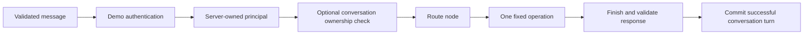

# SupportOps

A local customer-support workflow demonstrating Python API contracts, customer ownership, persistent conversations and bounded failure handling. This is a mock-only MLH code-sample candidate prepared for Abeeb Adesina Adeola, with a supplied starter and substantial Codex assistance credited in [ATTRIBUTION.md](ATTRIBUTION.md).

The application answers limited questions about fictional orders and policies. It creates unsaved review drafts; it never issues refunds, sends messages or changes an order. Routing is deterministic keyword matching, not language-model reasoning.

## Start here

1. Read the [attribution and scope](ATTRIBUTION.md).
2. Run the tests and the six-step demonstration below.
3. Follow the [code walkthrough](docs/WALKTHROUGH.md), starting with one order request.
4. Practise the [exercises and interview questions](docs/EXPLAIN_IT.md).

## Run on Windows

Use Python 3.11-3.13. In this folder, create your own environment; no virtual environment is included in the archive.

```powershell
py -3.12 -m venv .venv
.\.venv\Scripts\python.exe -m pip install -e ".[dev]"
.\.venv\Scripts\python.exe -m pytest -q
.\.venv\Scripts\python.exe scripts\demo_m1.py --output artifacts\first-demo
```

Choose `1`, `2`, `3`, `4`, `5`, `6`, then `q`. The output directory must not already exist. This demonstration uses FastAPI TestClient in process; it is not a deployed server.

| Choice | What to expect |
|---|---|
| 1 | Customer A creates a server-assigned conversation UUID; HTTP 201 |
| 2 | A reads fictional order ORD-1001; HTTP 200, turn count 1 |
| 3 | A asks when it will arrive; the authorized order reference is reused; turn count 2 |
| 4 | B attempts A's conversation; HTTP 404 without disclosing it |
| 5 | A trusted test harness sets a one-step budget; HTTP 503 with `step_limit` |
| 6 | A recovers on the normal configuration; HTTP 200, turn count 3 |

The controlled budget in choice 5 is constructed inside the demo, not accepted from an API request. No application network connections or model calls are permitted in that script.

To run the local browser/API separately:

```powershell
.\.venv\Scripts\python.exe -m uvicorn supportops.main:app --host 127.0.0.1 --port 8000
```

Open `http://127.0.0.1:8000`. The browser and `/v1/chat` are stateless. Persistent conversation endpoints are separate; see the walkthrough. Ctrl+C stops the server. Do not expose it publicly: the customer tokens are published demo fixtures, not secure production credentials. The optional Swagger `/docs` page may load external CDN assets.

On Linux/macOS use `python3 -m venv .venv` and `.venv/bin/python` in the same commands. Only the recorded Windows/Python environment has been tested for this candidate; these other setup commands are provided for reproduction, not claimed verification.

## Design



Authentication and validation are FastAPI request-processing boundaries; the diagram shows their logical relationship, not a guarantee about dependency evaluation order. Identity travels in trusted runtime context. Message text and saved memory cannot grant access to an order. The order tool checks both the order ID and the authenticated customer on every read.

## Source map

| File | Responsibility |
|---|---|
| `src/supportops/main.py` | Application construction, HTTP endpoints and safe error responses |
| `src/supportops/auth.py` | Published demo-token mapping to an immutable principal |
| `src/supportops/schemas.py` | Strict request, response and conversation contracts |
| `src/supportops/provider.py` | Deterministic route planning and fixed response operations |
| `src/supportops/tools.py` | Owner-scoped order read and fictional policy fixtures |
| `src/supportops/graph.py` | Explicit route, operation and finish nodes; trusted context |
| `src/supportops/conversations.py` | SQLite ownership, checkpoints and atomic turns |
| `src/supportops/execution.py` | Work counters, caller deadlines, finite read-only workers and safe logs |
| `tests/` | Inherited regression coverage plus mock-only sample boundary checks |

## Evidence and limits

Read [verification](docs/VERIFICATION.md) for actual commands and results. The core regression files were copied byte for byte from the working source; five additional cases check this candidate's mock-only scope. New results apply to this candidate, not to a byte-identical reconstruction of the historical M1 release. The separate provider extension remains blocked in the original workspace and is excluded here with its provider-specific tests and dependencies. No original working files or tests were removed or weakened.

The source supports two fictional customers and a tiny fixture dataset. It has no live model, semantic retrieval, real customer operation, deployed service or financial execution. SQLite data are plaintext; retention, backup, production authentication, rate limiting and distributed operation require additional work. A timeout stops the caller waiting; it cannot kill arbitrary blocking Python. Four worker slots include timed-out operations until they exit, so capacity can be exhausted. No universal real-time or exactly-once guarantee is claimed.

Dependency versions are pinned for reproduction, not certified as vulnerability-free. Installation normally needs package-registry access. No keys or model downloads are needed. The `.env.example` file documents settings and is not automatically loaded.

## Publication status

This candidate is local and has not been pushed or submitted to MLH. The owner confirmed that the starter was generated for him in ChatGPT; see [attribution and release notes](ATTRIBUTION.md#rights-and-release). No open-source license or third-party upstream author has been invented. A GitHub source URL and explicitly scoped publishing approval are still needed before public distribution. The existing portfolio URL is a case study, not this source repository.
